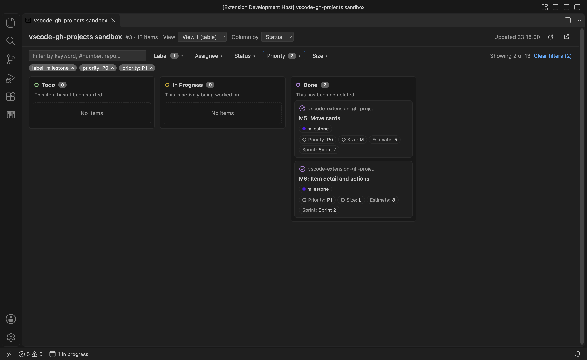
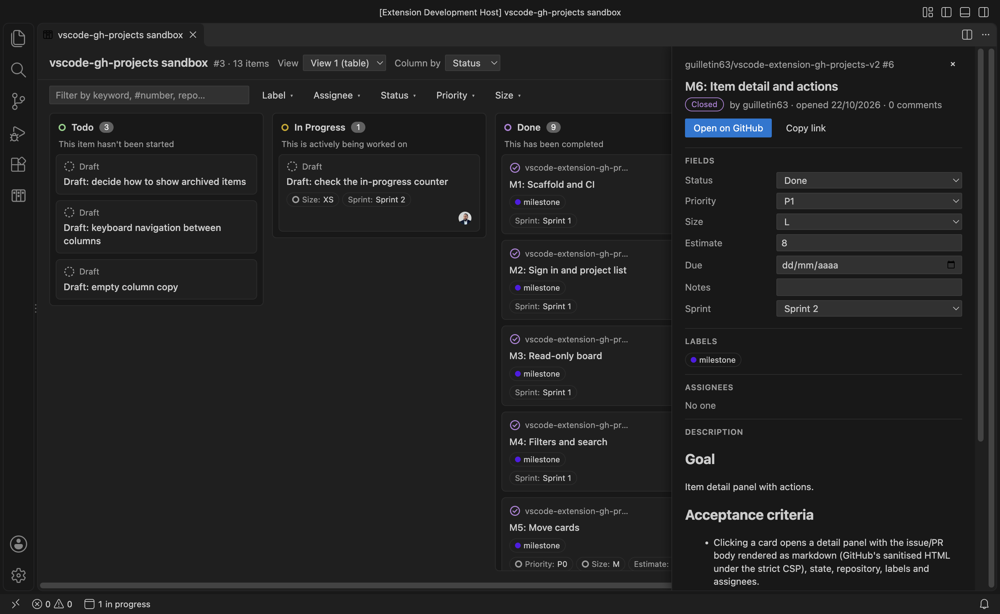

# GitHub Projects Boards for VS Code

Work with **GitHub Projects (v2)** boards without leaving the editor: the same board you see at
`github.com/users/<owner>/projects/<n>`, with columns by Status and cards you can move.

## Features

- **Projects tree** in the Activity Bar: your user, your organizations and any owner you add,
  with their open projects and views.
- **Board** grouped by the view's "Column by" field (or `Status`, or the first single-select
  field). Cards show number, title, repository, labels, assignees and custom fields
  (single-select, iteration, number, date, text). Works with projects of any size: items are
  loaded 100 at a time.
- **Move cards** by drag & drop, with the **Move** menu or with <kbd>Alt</kbd>+<kbd>←</kbd>/<kbd>→</kbd>.
  The card moves at once; if GitHub rejects the change it goes back and you get a warning.
- **Filters and search**: free text (`#123`, repository, labels…) plus label, assignee and any
  single-select field. Filters are remembered per project and workspace.
- **Item details**: the issue or pull request body, its project fields (editable), labels and
  assignees, with **Open on GitHub**, **Copy link** and, if the
  [GitHub Pull Requests](https://marketplace.visualstudio.com/items?itemName=GitHub.vscode-pull-request-github)
  extension is installed, **Open in GitHub Pull Requests**.
- **Refresh** on demand, optional polling and a status bar counter of the items assigned to you
  that are "In progress".

## Getting started

1. Open the **GitHub Projects** view in the Activity Bar and choose **Sign in to GitHub**.
   The extension uses the GitHub account VS Code already knows.
2. Expand an owner, then click a project (or one of its views) to open its board.
3. Use **Add Owner…** in the view title to browse an organization that doesn't appear on its own.

## Permissions and privacy

- Sign-in goes through VS Code's built-in GitHub authentication. Reading asks for the
  `read:project` and `repo` scopes. The first time you move a card or edit a field, VS Code asks
  for the `project` scope.
- Tokens are never written to settings, disk or logs by this extension.
- No telemetry. The extension only talks to `api.github.com`.
- The board runs in a webview with a strict Content Security Policy and no remote scripts.

## Settings

| Setting | Default | Description |
| --- | --- | --- |
| `ghProjects.refreshInterval` | `0` | Seconds between automatic refreshes of visible boards and the counter. `0` disables polling; the minimum is 30. Polling pauses while the window is not focused and slows down when GitHub rate-limits. |
| `ghProjects.inProgressColumn` | `In progress` | Column counted in the status bar for items assigned to you (case-insensitive). |

## Commands

- **GitHub Projects: Sign in to GitHub**
- **GitHub Projects: Refresh** (tree and open boards)
- **GitHub Projects: Add Owner…**
- **GitHub Projects: Open Last Board**

## Known limitations

- The view's own GitHub filter (`is:open label:bug …`) is not applied; use the board's filters.
- Moving a card changes its column only; the order inside a column follows the project.
- Organizations whose membership is private may not be listed automatically; add them with
  **Add Owner…**.

## Contributing

See [CONTRIBUTING.md](CONTRIBUTING.md) for the architecture, commands and tests.

## License

[MIT](LICENSE)
